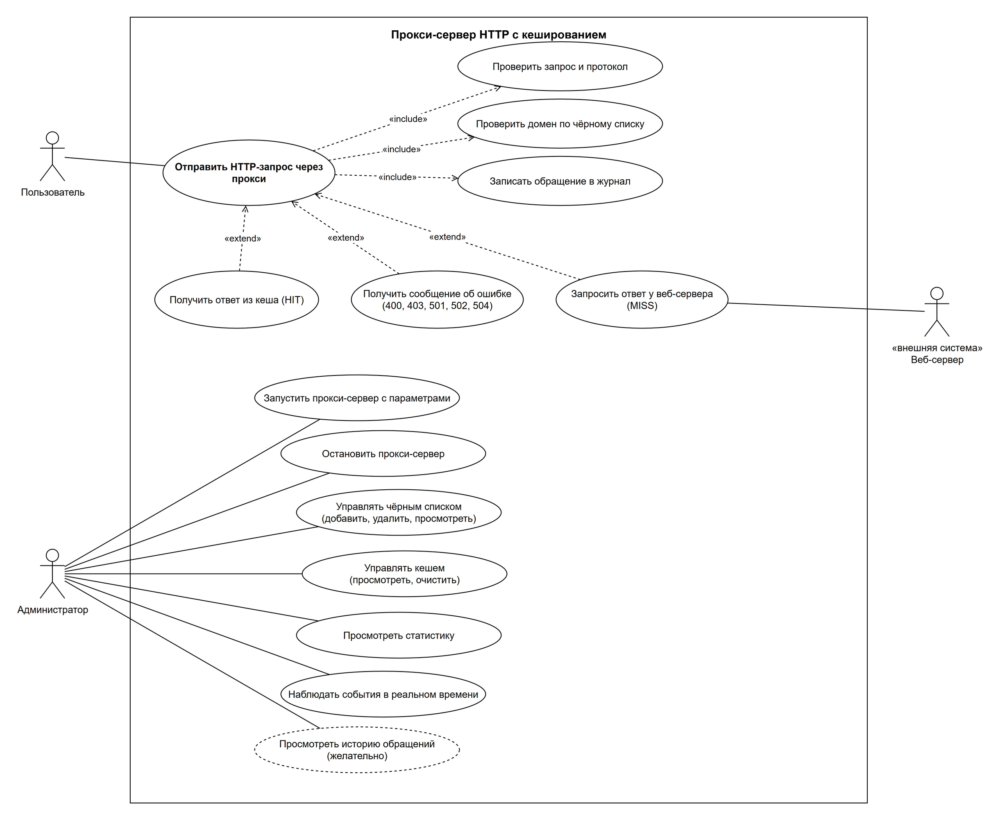
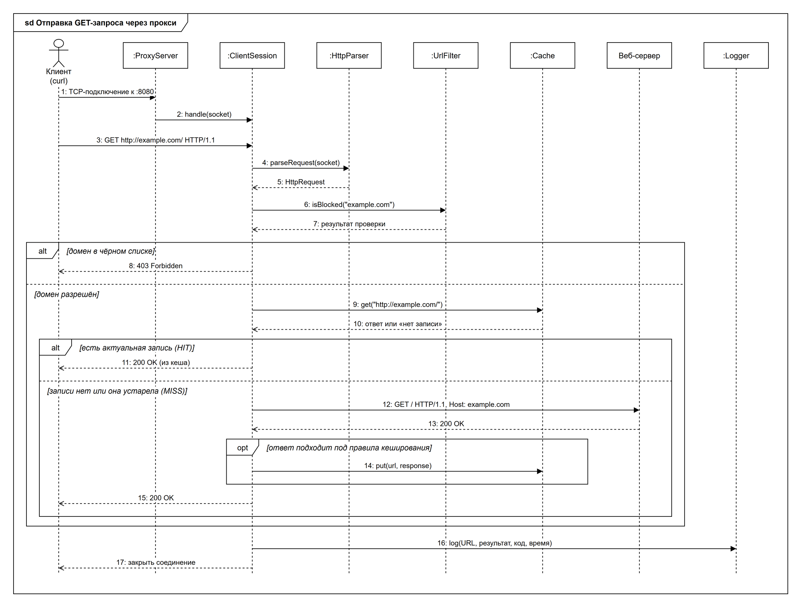

# Прокси-сервер HTTP с кешированием

## Спецификация требований к программному обеспечению (SRS)

| | |
|---|---|
| **Дисциплина** | Технологии индустриального программирования |
| **Институт** | Институт перспективных технологий и индустриального программирования |
| **Кафедра** | Индустриального программирования |
| **Преподаватель** | Афонин Сергей Александрович |
| **Студент** | Захаров Александр Сергеевич |
| **Группа** | ЭФБО-04-25 |
| **Учебный год** | 2026–2027 |

---

## Содержание

1. [Введение](#1-введение)
   - 1.1. [Цель](#11-цель)
   - 1.2. [Определения и аббревиатуры](#12-определения-и-аббревиатуры)
2. [Общее описание](#2-общее-описание)
   - 2.1. [Описание продукта](#21-описание-продукта)
   - 2.2. [Функции продукта](#22-функции-продукта)
   - 2.3. [Характеристики пользователей](#23-характеристики-пользователей)
   - 2.4. [Предположения и зависимости](#24-предположения-и-зависимости)
3. [Детальные требования](#3-детальные-требования)
   - 3.1. [Методология сбора требований](#31-методология-сбора-требований)
   - 3.2. [Бизнес-требования](#32-бизнес-требования)
   - 3.3. [Пользовательские требования](#33-пользовательские-требования)
   - 3.4. [Функциональные требования](#34-функциональные-требования)
   - 3.5. [Нефункциональные требования](#35-нефункциональные-требования)
   - 3.6. [Матрица прослеживаемости](#36-матрица-прослеживаемости)
4. [Диаграммы UML](#4-диаграммы-uml)
   - 4.1. [Диаграмма вариантов использования](#41-диаграмма-вариантов-использования)
   - 4.2. [Диаграмма последовательности](#42-диаграмма-последовательности)

---

## 1. Введение

### 1.1. Цель

Документ описывает требования к программе «Прокси-сервер HTTP с кешированием». Он нужен, чтобы зафиксировать, что должна делать система и какими свойствами обладать, до начала разработки. Документ предназначен для разработчиков проекта и преподавателя, принимающего работу.

### 1.2. Определения и аббревиатуры

| Термин | Определение |
|---|---|
| **Прокси-сервер** | Программа-посредник, которая принимает запросы клиентов и выполняет их от своего имени. |
| **Клиент** | Программа, отправляющая запросы через прокси; в проекте — утилита curl. |
| **Веб-сервер** | Внешний сервер, на котором находится запрашиваемый ресурс. |
| **HTTP** | HyperText Transfer Protocol — протокол передачи гипертекста. |
| **HTTPS** | HTTP поверх шифрованного соединения TLS. |
| **URL** | Uniform Resource Locator — адрес ресурса, например `http://example.com/index.html`. |
| **curl** | Консольная утилита для отправки HTTP-запросов и получения ответов. Адрес прокси задаётся параметром `-x`, например: `curl -x http://localhost:8080 http://example.com/`. |
| **Кеш** | Хранилище ранее полученных ответов в оперативной памяти. |
| **HIT** | Попадание в кеш: ответ найден в кеше и отдан из него. |
| **MISS** | Промах кеша: ответ не взят из кеша (его там нет, он устарел или запрос не подлежит кешированию), запрос отправлен веб-серверу. |
| **BLOCKED** | Запрос отклонён, потому что домен находится в чёрном списке. |
| **ERROR** | Запрос завершился ошибкой: он составлен некорректно, протокол не поддерживается, веб-сервер недоступен или не ответил вовремя (коды `400`, `501`, `502`, `504`). |
| **TTL** | Time To Live — время, в течение которого запись кеша считается актуальной. |
| **LRU** | Least Recently Used — правило вытеснения: при нехватке места удаляется запись, к которой дольше всего не обращались. |
| **Чёрный список** | Список доменов, обращение к которым запрещено. |
| **TCP** | Transmission Control Protocol — транспортный протокол, поверх которого работает HTTP. |
| **Сокет** | Один из двух концов сетевого соединения внутри программы, через который она отправляет и получает данные. Определяется IP-адресом и портом. |
| **MVP** | Minimum Viable Product — минимальная работоспособная версия продукта. |
| **SRS** | Software Requirements Specification — спецификация требований к ПО. |
| **БТ / ПТ / ФТ / НФТ** | Бизнес-, пользовательские, функциональные и нефункциональные требования. |

**Коды ответов HTTP, используемые в документе**

| Код | Значение |
|---|---|
| `200 OK` | Запрос выполнен, ресурс получен. |
| `400 Bad Request` | Запрос составлен некорректно. |
| `403 Forbidden` | Доступ запрещён: домен в чёрном списке. |
| `501 Not Implemented` | Протокол или метод не поддерживается прокси. |
| `502 Bad Gateway` | Не удалось подключиться к веб-серверу. |
| `504 Gateway Timeout` | Веб-сервер не ответил за отведённое время. |

**Методы HTTP-запросов, используемые в документе.** Метод указывает, какое действие клиент просит выполнить с ресурсом.

| Метод | Назначение |
|---|---|
| `GET` | Получить ресурс (страницу, файл). Данные на веб-сервере не изменяются, поэтому ответ можно сохранить и выдать повторно. |
| `POST` | Отправить данные на веб-сервер (например, заполненную форму). Может изменять данные на веб-сервере, поэтому ответ не сохраняется. |

---

## 2. Общее описание

### 2.1. Описание продукта

Прокси-сервер HTTP с кешированием — программа-посредник между клиентами и веб-серверами. Клиент отправляет запрос не напрямую веб-серверу, а прокси-серверу; тот проверяет запрос, при необходимости обращается к веб-серверу и возвращает клиенту ответ. Благодаря этому прокси-сервер может ограничивать доступ к ресурсам, вести учёт обращений и ускорять повторные запросы за счёт кеша.

**Состав программы.** Прокси-сервер — консольное приложение, которое запускается в окне командной строки. В нём одновременно работают две части:

1. **Сервер** работает в фоновом режиме и не занимает окно. Он принимает подключения клиентов на порту (по умолчанию 8080), проверяет запросы по чёрному списку, отдаёт ответы из кеша или запрашивает их у веб-сервера и записывает каждое обращение в журнал (файл). Кеш хранится в оперативной памяти.
2. **Консоль администратора** работает в окне программы. Через неё администратор смотрит статистику, управляет кешем и чёрным списком, наблюдает за событиями сервера в реальном времени и останавливает сервер.

Пользователь с программой напрямую не взаимодействует: он отправляет запросы через curl, указывая адрес прокси параметром `-x`.

**Пример работы:**

```
> proxy.exe --port 8080
[12:00:01] Proxy listening on 0.0.0.0:8080
> block add ads.tracker.com
Domain ads.tracker.com added to blocklist.
> watch
Watch mode. Press Enter to exit.
[12:00:07] 127.0.0.1  GET http://example.com/          MISS     200  1256 B  184 ms
[12:00:09] 127.0.0.1  GET http://example.com/          HIT      200  1256 B    1 ms
[12:00:15] 127.0.0.1  GET http://ads.tracker.com/x.js  BLOCKED  403
                                                       ← нажат Enter
> stats
Requests: 3 | HIT: 1 (33%) | MISS: 1 | BLOCKED: 1 | ERROR: 0
```

Запросы в примере пользователь отправляет из другого окна, например:

```
curl -x http://localhost:8080 http://example.com/
```

**Как работает кеш.** Прокси запоминает ответы веб-серверов, чтобы при повторном обращении к тому же адресу не запрашивать их заново.

Ответ сохраняется, если одновременно выполнены условия:
- клиент запросил ресурс методом `GET`;
- веб-сервер вернул ресурс без ошибки.

Ответы на другие методы (например, `POST`) и ответы с ошибками не сохраняются.

Исключения — даже при выполнении этих условий не сохраняются:
- ответы, которые веб-сервер пометил как личные или не подлежащие сохранению (например, страница профиля пользователя);
- ответы, размер которых превышает лимит кеша.

Ответ берётся из кеша, если:
- по этому же адресу (с учётом пути и параметров) уже сохранён ответ;
- он ещё не устарел — время актуальности задаёт администратор параметром `--cache-ttl` (по умолчанию 5 минут).

В остальных случаях (ответа нет, он устарел или кеш очищен) прокси обращается к веб-серверу напрямую и сохраняет новый ответ, если он подходит под правила выше.

Запросы к доменам из чёрного списка до кеша не доходят: они отклоняются раньше.

### 2.2. Функции продукта

- Приём и пересылка HTTP-запросов.
- Фильтрация запросов по чёрному списку доменов.
- Кеширование ответов с ограничением по времени жизни и объёму.
- Ведение журнала обращений и статистики работы.
- Управление прокси-сервером (консольным приложением) с помощью команд администратора.

### 2.3. Характеристики пользователей

| Роль | Описание | Как взаимодействует с системой |
|---|---|---|
| **Пользователь** | Человек, который запрашивает веб-ресурсы через прокси. | Косвенно, через утилиту curl. |
| **Администратор** | Человек, который запускает и настраивает прокси. | Напрямую, через параметры запуска и консоль прокси. |

### 2.4. Предположения и зависимости

- Администратором считается тот, у кого есть доступ к консоли прокси-сервера. Отдельная аутентификация администратора в MVP не требуется.
- На компьютере, где работает прокси, есть доступ к сети Интернет.
- Пользователь указывает адрес прокси при каждом запросе (параметр `-x` утилиты curl).

---

## 3. Детальные требования

### 3.1. Методология сбора требований

Проект учебный, поэтому роль заказчика выполняет сам разработчик. Требования собирались так:

1. **User Stories.** Пользовательские требования сформулированы как истории «Как *роль*, я хочу *действие*, чтобы *ценность*». Каждой истории присвоен приоритет: *Обязательно* (входит в MVP) или *Желательно* (реализуется при наличии времени).
2. **Итеративное уточнение.** Первоначальный черновик требований пересматривался в ходе обсуждения: уточнялись роли, граница проекта, поведение при ошибках и значения параметров по умолчанию.

Требования разбиты по уровням иерархии К. Вигерса: бизнес-требования → пользовательские → функциональные и нефункциональные. Каждое пользовательское и функциональное требование ссылается на требование верхнего уровня (см. п. 3.6).

### 3.2. Бизнес-требования

**Цель системы:** обеспечить контроль и мониторинг HTTP-трафика, а также ускорить доступ к часто запрашиваемым ресурсам.

Для достижения цели система должна обеспечить:

| ID | Требование |
|---|---|
| **БТ-1** | Ограничение доступа к нежелательным ресурсам (контроль). |
| **БТ-2** | Учёт обращений пользователей к ресурсам (мониторинг). |
| **БТ-3** | Ускорение ответов и снижение нагрузки на внешний канал за счёт повторного использования ответов (кеширование). |

### 3.3. Пользовательские требования

| ID | User Story | Приоритет | БТ |
|---|---|---|---|
| **ПТ-1** | Как **пользователь**, я хочу обращаться к незапрещённым веб-ресурсам через прокси, чтобы получать нужную информацию. | Обязательно | БТ-1 |
| **ПТ-2** | Как **пользователь**, я хочу получать ответ сервера или понятное сообщение об ошибке (доступ запрещён, сервер недоступен), чтобы понимать, почему ресурс не открылся. | Обязательно | БТ-1 |
| **ПТ-3** | Как **пользователь**, я хочу быстрее получать повторно запрашиваемые ресурсы, чтобы меньше ждать. | Обязательно | БТ-3 |
| **ПТ-4** | Как **администратор**, я хочу запускать прокси на выбранном порту и останавливать его, чтобы управлять работой сервера. | Обязательно | БТ-1, БТ-2, БТ-3 |
| **ПТ-5** | Как **администратор**, я хочу добавлять, удалять и просматривать домены в чёрном списке, чтобы ограничивать доступ к нежелательным ресурсам. | Обязательно | БТ-1 |
| **ПТ-6** | Как **администратор**, я хочу видеть статистику работы (HIT / MISS / BLOCKED), чтобы оценивать эффективность кеша и фильтрации. | Обязательно | БТ-2, БТ-3 |
| **ПТ-7** | Как **администратор**, я хочу просматривать и очищать кеш, чтобы при необходимости получить свежие данные. | Обязательно | БТ-3 |
| **ПТ-8** | Как **администратор**, я хочу просматривать историю обращений пользователей, чтобы знать, куда идёт трафик. | Желательно | БТ-2 |
| **ПТ-9** | Как **администратор**, я хочу видеть события в реальном времени, чтобы сразу замечать, например, попытки доступа к запрещённым ресурсам. | Обязательно | БТ-2 |

### 3.4. Функциональные требования

#### 3.4.1. Запуск и приём запросов

| ID | Требование | ПТ |
|---|---|---|
| **ФТ-1** | Система должна принимать HTTP-запросы клиентов на порту, заданном параметром `--port`. | ПТ-4 |
| **ФТ-1.1** | Если порт занят или любой параметр запуска указан неверно (например, `--cache-ttl abc`), система должна вывести сообщение об ошибке и завершить работу. | ПТ-4 |
| **ФТ-2** | Система должна обслуживать несколько клиентов одновременно: медленный ответ одному клиенту не задерживает обработку запросов других. | ПТ-1 |
| **ФТ-3** | Система должна разбирать запрос HTTP/1.1: стартовую строку (метод, URL, версию), заголовки и тело по `Content-Length`. На некорректный запрос система должна вернуть `400 Bad Request`. | ПТ-1, ПТ-2 |
| **ФТ-4** | Система должна обрабатывать только запросы по протоколу HTTP; на любой другой запрос — возвращать `501 Not Implemented`. | ПТ-2 |

#### 3.4.2. Фильтрация

| ID | Требование | ПТ |
|---|---|---|
| **ФТ-5** | Система должна проверять домен каждого запроса по чёрному списку, включая поддомены: запись `example.com` блокирует и `example.com`, и `ads.example.com`. | ПТ-1, ПТ-5 |
| **ФТ-6** | На запрос к запрещённому домену система должна вернуть `403 Forbidden` с HTML-страницей «Access Denied». | ПТ-2 |
| **ФТ-7** | Система должна при запуске загружать чёрный список из файла, заданного параметром `--blocklist`, и сохранять его в этот файл при каждом изменении. Если файла нет, система должна начать работу с пустым чёрным списком и создать файл. | ПТ-5 |

#### 3.4.3. Кеширование

| ID | Требование | ПТ |
|---|---|---|
| **ФТ-8** | Система должна кешировать ответы на GET-запросы с кодом `200 OK`, кроме ответов с заголовком `Cache-Control: no-store` или `private`. Ключ кеша — полный URL. | ПТ-3 |
| **ФТ-9** | Если в кеше есть актуальная запись, система должна вернуть ответ из кеша без обращения к веб-серверу. | ПТ-3 |
| **ФТ-10** | Запись кеша считается актуальной в течение времени, заданного параметром `--cache-ttl`. Устаревшая запись считается отсутствующей и удаляется из кеша. | ПТ-3 |
| **ФТ-11** | Объём кеша ограничен значением параметра `--cache-size`. При переполнении система должна удалять записи по правилу LRU. Ответ, размер которого превышает лимит кеша, не кешируется. | ПТ-3 |

#### 3.4.4. Пересылка запросов

| ID | Требование | ПТ |
|---|---|---|
| **ФТ-12** | При промахе кеша (MISS) система должна подключиться к веб-серверу, переслать запрос и вернуть клиенту полученный ответ. | ПТ-1 |
| **ФТ-12.1** | Запросы с методами, отличными от `GET` (например, `POST`), система должна пересылать веб-серверу без поиска в кеше и возвращать клиенту полученный ответ. В журнале такие запросы отмечаются как MISS. | ПТ-1 |
| **ФТ-13** | Если веб-сервер не ответил за время, заданное параметром `--timeout`, система должна вернуть клиенту `504 Gateway Timeout`. | ПТ-2 |
| **ФТ-14** | Если не удалось определить адрес веб-сервера, подключиться к нему или получить от него корректный ответ (соединение оборвалось, ответ не удалось разобрать), система должна вернуть клиенту `502 Bad Gateway`. | ПТ-2 |

#### 3.4.5. Журнал и статистика

| ID | Требование | ПТ |
|---|---|---|
| **ФТ-15** | Система должна записывать каждый запрос в журнал: время, IP клиента, метод, URL, результат (HIT / MISS / BLOCKED / ERROR), код ответа, размер ответа, время обработки. Журнал всегда пишется в файл `proxy.log`. | ПТ-6, ПТ-8 |
| **ФТ-15.1** | По команде `watch` система должна переходить в режим наблюдения: выводить новые записи журнала в консоль по мере их появления. По нажатию Enter система должна выходить из режима наблюдения и снова принимать команды. Вне режима наблюдения записи журнала в консоль не выводятся. | ПТ-9 |
| **ФТ-15.2** | Служебные сообщения (запуск сервера, ошибки запуска, завершение работы) система должна выводить в консоль всегда, независимо от режима. | ПТ-4 |
| **ФТ-16** | Система должна вести счётчики запросов по каждому результату и показывать долю попаданий в кеш. Счётчики ведутся с момента запуска сервера и обнуляются при перезапуске. | ПТ-6 |

#### 3.4.6. Консоль администратора и параметры запуска

| ID | Требование | ПТ |
|---|---|---|
| **ФТ-17** | Система должна поддерживать команды администратора (см. таблицу ниже). | ПТ-4 – ПТ-9 |
| **ФТ-18** | Изменения чёрного списка должны применяться сразу, без перезапуска сервера. | ПТ-5 |
| **ФТ-19** | По команде `quit` система должна прекратить приём новых подключений, закрыть активные соединения, сохранить чёрный список и завершить работу. | ПТ-4 |
| **ФТ-20** | На неизвестную команду система должна вывести сообщение об ошибке и подсказку `help`. | ПТ-4 |

**Команды консоли**

| Команда | Действие |
|---|---|
| `help` | Показать список команд. |
| `stats` | Показать статистику: всего запросов, HIT, MISS, BLOCKED, ERROR, доля HIT. |
| `cache list` | Показать записи кеша: URL, размер, оставшееся время жизни. |
| `cache clear` | Очистить кеш. |
| `block add <домен>` | Добавить домен в чёрный список. |
| `block remove <домен>` | Удалить домен из чёрного списка. |
| `block list` | Показать чёрный список. |
| `watch` | Включить режим наблюдения: события выводятся в консоль в реальном времени. Выход — Enter. |
| `history [N]` | Показать последние N записей журнала (по умолчанию 20). *Желательно.* |
| `quit` | Остановить сервер и выйти. |

**Параметры запуска**

| Параметр | Назначение | По умолчанию |
|---|---|---|
| `--port <число>` | Порт, на котором прокси принимает подключения. | 8080 |
| `--blocklist <файл>` | Файл чёрного списка (один домен на строку). | `blocked.txt` |
| `--cache-ttl <секунды>` | Время, в течение которого запись кеша актуальна. | 300 (5 минут) |
| `--cache-size <МБ>` | Максимальный объём кеша. | 100 |
| `--timeout <секунды>` | Время ожидания ответа веб-сервера. | 10 |

#### 3.4.7. Сценарии использования

**Сценарий 1. Пользователь отправляет запрос через прокси.**

1. Пользователь отправляет запрос к веб-серверу через прокси-сервер.
2. Прокси-сервер проверяет корректность запроса и протокол:
   - если запрос составлен некорректно — возвращает `400 Bad Request` и переходит к шагу 6;
   - если протокол не HTTP — возвращает `501 Not Implemented` и переходит к шагу 6;
   - иначе — переходит к шагу 3.
3. Прокси-сервер проверяет домен по чёрному списку:
   - если домен в чёрном списке — возвращает `403 Forbidden` и переходит к шагу 6;
   - иначе — переходит к шагу 4.
4. Прокси-сервер ищет ответ в кеше:
   - если запрос сделан методом `GET` и в кеше есть актуальный ответ — возвращает ответ из кеша (HIT) и переходит к шагу 6;
   - иначе — переходит к шагу 5.
5. Прокси-сервер выполняет прямой запрос к веб-серверу и возвращает ответ клиенту (MISS). Если ответ подходит под правила кеширования, сохраняет его в кеш.
6. Прокси-сервер записывает обращение в журнал.

*Альтернативные потоки:*
- 5а. Веб-сервер не ответил за время `--timeout` → `504 Gateway Timeout`, переход к шагу 6.
- 5б. Веб-сервер недоступен → `502 Bad Gateway`, переход к шагу 6.

**Сценарий 2. Администратор настраивает чёрный список.**

1. Администратор открывает консоль работающего прокси-сервера.
2. Вводит команду `block add <домен>` или `block remove <домен>`.
3. Система обновляет список, сохраняет его в файл и выводит подтверждение.
4. Последующие запросы проверяются по обновлённому списку.

*Альтернативные потоки:*
- 2а. Домен указан некорректно → система выводит сообщение об ошибке, список не меняется.
- 2б. При добавлении: домен уже есть в списке → система выводит сообщение, список не меняется.
- 2в. При удалении: домена нет в списке → система выводит сообщение, список не меняется.

### 3.5. Нефункциональные требования

#### 3.5.1. Атрибуты качества

| ID | Категория | Требование |
|---|---|---|
| **НФТ-1** | Производительность | Ответ из кеша отдаётся не более чем за 10 мс с момента получения запроса (на локальной машине). Проверяется по времени обработки в журнале. |
| **НФТ-2** | Производительность | Система обслуживает не менее 10 клиентов одновременно без отказов. |
| **НФТ-3** | Использование ресурсов | Объём памяти, занятый кешем, не превышает заданного лимита (по умолчанию 100 МБ). |
| **НФТ-4** | Надёжность | Ошибка в одном соединении (обрыв, некорректный запрос) не влияет на другие соединения и не приводит к остановке сервера. |
| **НФТ-5** | Надёжность | Одновременные запросы разных клиентов не приводят к повреждению кеша, чёрного списка и статистики. |
| **НФТ-6** | Удобство использования | Каждая запись журнала занимает одну строку; у всех команд консоли есть описание в `help`. |
| **НФТ-6.1** | Удобство использования | Вне режима наблюдения ввод команд не прерывается выводом событий. |
| **НФТ-7** | Сопровождаемость | Сетевая часть, разбор HTTP, кеш, фильтр и журнал реализованы в отдельных классах; все параметры собраны в одной структуре конфигурации. |
| **НФТ-8** | Переносимость | Работа с сокетами вынесена в отдельный класс, чтобы программу можно было перенести на Linux. *Желательно.* |

#### 3.5.2. Ограничения

| ID | Ограничение |
|---|---|
| **О-1** | Язык программирования — C++ (стандарт C++17). |
| **О-2** | Используется стандартная библиотека C++ и Winsock2. Готовые библиотеки HTTP-серверов, прокси и кеширования не используются: разбор HTTP, кеш и фильтр реализуются самостоятельно. |
| **О-3** | Поддерживается только протокол HTTP/1.1 без шифрования; HTTPS не поддерживается. |
| **О-4** | Кеш хранится только в оперативной памяти и очищается при перезапуске. |

#### 3.5.3. Системные требования

| ID | Требование |
|---|---|
| **С-1** | Программа — консольное приложение. |
| **С-2** | ОС: Windows 10 / 11, x64. |
| **С-3** | Сборка: MSVC 2019+ или MinGW-w64 (GCC 9+), система сборки CMake. |
| **С-4** | Наличие сетевого подключения и свободного TCP-порта. |

### 3.6. Матрица прослеживаемости

| БТ | ПТ | ФТ |
|---|---|---|
| БТ-1 (контроль) | ПТ-1, ПТ-2, ПТ-4, ПТ-5 | ФТ-1 – ФТ-7, ФТ-12 – ФТ-14, ФТ-17 – ФТ-20 |
| БТ-2 (мониторинг) | ПТ-4, ПТ-6, ПТ-8, ПТ-9 | ФТ-15 – ФТ-15.2, ФТ-16, ФТ-17 |
| БТ-3 (кеширование) | ПТ-3, ПТ-4, ПТ-6, ПТ-7 | ФТ-8 – ФТ-11, ФТ-15, ФТ-16, ФТ-17 |

---

## 4. Диаграммы UML

### 4.1. Диаграмма вариантов использования



### 4.2. Диаграмма последовательности



Диаграмма детализирует сценарий 1 (п. 3.4.7) — обработку GET-запроса пользователя.

**Участники**

| Участник | Роль |
|---|---|
| Клиент (curl) | Программа пользователя, отправляющая запрос через прокси. |
| `:ProxyServer` | Принимает подключения на порту и передаёт каждое на обработку отдельной сессии. |
| `:ClientSession` | Обслуживает одно подключение от приёма запроса до закрытия соединения. |
| `:HttpParser` | Разбирает поступившие из сокета байты в структуру HTTP-запроса. |
| `:UrlFilter` | Проверяет домен по чёрному списку. |
| `:Cache` | Хранит сохранённые ответы и выдаёт их по URL. |
| Веб-сервер | Внешний сервер, на котором находится запрашиваемый ресурс. |
| `:Logger` | Записывает обращения в журнал. |

**Ход взаимодействия**

1. **Подключение (сообщения 1–2).** Клиент устанавливает TCP-соединение с прокси на порту 8080. `ProxyServer` передаёт сокет нового подключения в `ClientSession` и возвращается к приёму других подключений.
2. **Приём и разбор запроса (3–5).** Клиент отправляет запрос `GET http://example.com/ HTTP/1.1`. `ClientSession` передаёт сокет в `HttpParser`, который возвращает разобранный запрос `HttpRequest` (метод, URL, хост, заголовки).
3. **Проверка домена (6–7).** `ClientSession` запрашивает у `UrlFilter`, не находится ли домен `example.com` в чёрном списке, и получает результат проверки.
4. **Внешний контур `alt` — запрещён или разрешён.**
   - *[домен в чёрном списке]* — прокси сразу возвращает клиенту `403 Forbidden` (8). Кеш и веб-сервер не используются.
   - *[домен разрешён]* — `ClientSession` ищет ответ в кеше по полному URL (9) и получает сохранённый ответ или сообщение об отсутствии записи (10).
5. **Внутренний контур `alt` — HIT или MISS.**
   - *[есть актуальная запись (HIT)]* — прокси возвращает клиенту ответ из кеша (11) без обращения к веб-серверу.
   - *[записи нет или она устарела (MISS)]* — прокси отправляет запрос веб-серверу (12). В запросе указывается только путь ресурса и заголовок `Host`, а не полный URL. Веб-сервер возвращает ответ (13).
6. **Контур `opt` — сохранение в кеш (14).** Если ответ подходит под правила кеширования (ФТ-8, ФТ-11), `ClientSession` сохраняет его в кеш. Иначе шаг пропускается.
7. **Ответ клиенту (15).** Прокси передаёт клиенту ответ веб-сервера.
8. **Завершение (16–17).** Сообщения расположены вне контуров и выполняются при любом исходе: `ClientSession` записывает обращение в журнал (URL, результат, код ответа, время обработки) и закрывает соединение с клиентом.

Код `200 OK` в сообщениях 13 и 15 — пример успешного ответа. Если веб-сервер вернул ошибку (например, `404 Not Found`), прокси передаёт её клиенту без изменений и не сохраняет в кеш. Случаи, когда веб-сервер не ответил или ответ получить не удалось (`504`, `502`, ФТ-13, ФТ-14), а также ошибки разбора запроса (`400`, `501`, ФТ-3, ФТ-4), на диаграмме не показаны; они описаны в сценарии 1 (шаг 2 и альтернативные потоки 5а, 5б).
